# Innledning

Denne oppgaven undersøker hvilke faktorer som henger sammen med boligpriser i Lucas County, Ohio, og om boligmarkedet viser romlige sammenhenger som gjør at vanlige regresjonsmodeller ikke er tilstrekkelige.
Analysen tar utgangspunkt i boligsalg fra perioden 1993-1998 og kombinerer boligdata med informasjon om nabolag, demografi og miljø fra ACS5 og EJScreen.

Oppgave 1-4 handler om innhenting, klargjøring og kobling av data, og vi har derfor valgt å samlet alt i ett kapittel om datagrunnlag og klargjøring.
Her beregnes blant annet avstand til Toledo sentrum, og det undersøkes hvordan boligpriser og boligareal fordeler seg geografisk.
Videre estimeres hedoniske boligprismodeller for å undersøke hvilke bolig-, nabolags- og miljøegenskaper som henger sammen med boligprisen.

Et viktig tema i oppgaven vår er om boliger som ligger nær hverandre også har priser som påvirkes av de samme lokale forholdene.
Vi tester derfor for romlig autokorrelasjon og sammenligner OLS med de romlige modellene SEM, SAR, SLX og SDEM.
Modellene sammenlignes blant annet ved hjelp av Moran's I, Rao's Score-tester, likelihood ratio-tester og AIC.
Til slutt sammenlignes resultatene for boligareal og inntekt på tvers av modellene, og direkte og indirekte effekter fra SAR-modellen diskuteres.

For å holde selve rapporten ryddig og oversiktlig har vi valgt å ikke vise R-koden som er brukt til analysene.
Tabeller og enkelte resultater er i stedet lagret som SVG-bilder og satt inn i rapporten.
Rapporten består derfor hovedsakelig av tekst, tabeller og figurer, mens selve koden holdes utenfor rapportteksten.

# Datagrunnlag og klargjøring

## Boligdata og avstand til sentrum

Utgangspunktet er datasettet `house` fra pakken `spData`, som inneholder 25 357 boligsalg i Lucas County, Ohio.
Variabeldefinisjonene i `house.txt` ble brukt som grunnlag for å forstå boligegenskapene og salgsvariablene før videre klargjøring.
Salgsdatoen `sdate` ble gjort om til datoformat, og det ble laget en faktorvariabel `year_month` med år og måned.

Boligdataene ble deretter konvertert til et `sf`-objekt og transformert til projeksjonen EPSG:2834.
For å måle sentralitet brukte vi koordinatene til Toledo Central Business District (CBD), −83,537778 og 41,652778.
CBD-punktet ble først opprettet med lon/lat i EPSG:4326 og deretter transformert til EPSG:2834, slik at punktet og boligene lå i samme projeksjon.
Luftlinjeavstanden fra hver bolig til CBD ble beregnet, konvertert til kilometer og lagret som `dist_CBD`.
På dette tidspunktet var alle 25 357 boligsalg fortsatt med i datasettet.

## Kobling av EJScreen-data

EJScreen 2015 brukes til å beskrive demografiske forhold og miljøbelastninger i nærområdet [@fitzgerald2025].
GeoPackage-filen for Lucas County ble lest inn, og variablene som var relevante for oppgaven ble plukket ut.
Disse omfatter demografiske variabler som `LINGISOPCT`, `LOWINCPCT`, `LESSHSPCT`, `OVER64PCT` og `VULEOPCT`, samt miljøvariabler som `PRE1960PCT`, `PTRAF`, `PWDIS`, `PNPL`, `PRMP`, `PTSDF`, `OZONE` og `PM25`.

EJScreen-kartet ble transformert til EPSG:2834.
Datasettet inneholdt opprinnelig 398 geografiske områder.
Tract 9900, med ID `390959900000`, hadde bare nullverdier på områdevariablene og ble derfor fjernet, slik at 397 områder gjensto.
Vannarealer ble fjernet med `erase_water()`, og `st_intersection()` ble brukt for å koble EJScreen-variablene til boligene.
Etter denne koblingen gjensto 25 352 boliger.

## Kobling av ACS5-data

ACS5-data for 2011 ble hentet gjennom `tidycensus` etter at API-nøkkelen var installert.
Tabellene ble lastet ned med `get_acs()`.
Vi hentet blant annet inn inntekt per capita, median husholdningsinntekt, etnisitet, arbeidsledighet, fattigdom og reisetid til arbeid.

Etnisitetsvariablene ble omgjort til andeler av befolkningen.
Gjennomsnittlig reisetid til arbeid (`mwtt`) ble beregnet som et vektet gjennomsnitt av tidsintervallene i ACS.
Gjennomsnittlig `mwtt` er 21,55 minutter og medianen 21,18 minutter, med minimum 12,16 og maksimum 31,63 minutter.
De ulike ACS-tabellene ble transformert til wide-format og samlet i datasettet `census_full` med `left_join()`.

ACS-datasettet besto først av 128 Census tracts.
Tract 9900 manglet inntektsinformasjon og ble fjernet, slik at 127 tracts gjensto.
`census_full` ble transformert til EPSG:2834, vannarealer ble fjernet, og `st_intersection()` ble brukt for å koble ACS5-dataene til boligdataene.
Etter denne koblingen gjensto 25 351 boligsalg.
Samlet falt dermed seks av de opprinnelige 25 357 observasjonene bort.

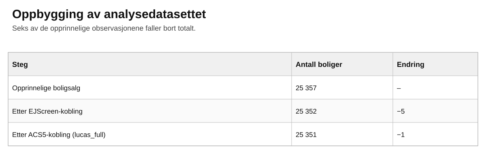{width="95%"}

Det endelige datasettet `lucas_full` inneholder boligegenskaper, salgsinformasjon, avstand til CBD, demografiske forhold og miljøvariabler for 25 351 boligsalg.
Datasettet ble lagret som en GeoPackage med `append = FALSE` og brukes videre i GeoDa og R.

# Utforskende analyse i GeoDa

Et nytt prosjekt ble opprettet i GeoDa med den ferdige GeoPackage-filen.
Det ble laget vektfiler basert på både 3 og 10 nærmeste naboer.
Disse to definisjonene av nabolag brukes videre for å undersøke hvor robuste de romlige mønstrene er.

## Boligpriser og beliggenhet

Salgsprisene varierer fra 2 000 til 875 000 dollar.
Medianen er 65 500 dollar og gjennomsnittet 79 013 dollar, mens de midterste 50 prosentene av boligene ligger mellom 41 900 og 97 000 dollar.
Fordelingen er dermed tydelig høyreskjev.

Når boligene deles inn i fem like store grupper etter avstand til CBD, øker medianprisen jevnt med avstanden.
Medianprisen er 25 000 dollar i gruppen nærmest sentrum og 118 500 dollar i gruppen lengst unna.
Dette er en ubetinget sammenheng og kan ikke tolkes som en kausal effekt av avstand.
Boligene lengre fra sentrum kan også være større, nyere eller ligge i andre typer nabolag.
Dette kontrolleres det for i de hedoniske modellene.

## Romlige mønstre i boligmarkedet

For å undersøke hvor små og dyre, store og dyre, store og billige og små og billige boliger ligger, bruker vi bivariat lokal Moran's I i GeoDa.
`TLA` er første variabel og `price` er andre variabel.
Statistikken sammenligner størrelsen på en bolig med gjennomsnittsprisen hos naboene.
Vi bruker både k = 3 og k = 10 nærmeste naboer.

De fire klyngetypene tolkes slik: høy-høy betyr store boliger i områder med høye priser, lav-lav betyr små boliger i områder med lave priser, høy-lav betyr store boliger i områder med lave priser, og lav-høy betyr små boliger i områder med høye priser.

{width="95%"}

{width="95%"}

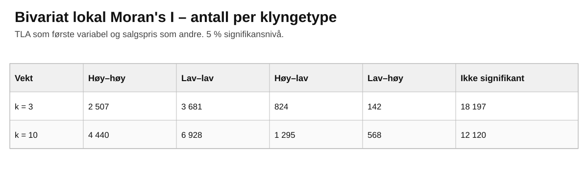{width="95%"}

Med k = 3 er 7 154 boliger, omtrent 28 %, del av en signifikant klynge på 5 %-nivå.
Med k = 10 øker dette til 13 231 boliger, omtrent 52 %.
Antallet observasjoner som er signifikante på 0,1 %-nivå øker samtidig fra 1 376 til 6 009.
Høy-høy og lav-lav dominerer i begge tilfeller.

Høy-høy-klyngene ligger særlig vest, nordvest og sørvest i studieområdet, mens lav-lav og høy-lav er mer konsentrert i sentrale og østlige områder.
Hovedmønsteret er likt for k = 3 og k = 10, men flere observasjoner blir signifikante når nabolaget utvides til ti naboer.
Analysen viser derfor tydelig romlig struktur i dataene.
Om den romlige strukturen også finnes i regresjonsresidualene testes senere med Moran's I.

# Hedoniske boligprismodeller

## Modellene

Vi estimerer tre modeller med alle 25 351 boligene.
Den avhengige variabelen er logaritmen av salgsprisen.
Boligareal og tomtestørrelse er også logaritmert, slik at koeffisientene kan tolkes som elastisiteter.
Modellene bygger på hedonisk pristeori [@bishop2020; @maslianskaia-pautrel2016].

**Modell 1** er nullmodellen og inneholder boligegenskaper og tidsdummyer (`year_month`).
**Modell 2** legger til `dist_CBD`, demografiske variabler fra EJScreen, tract-variabler fra ACS5 og tidsdummyer.
**Modell 3** legger i tillegg til miljøvariabler fra EJScreen.
På denne måten kan vi se hvor mye modelltilpasningen forbedres når nabolags- og miljøinformasjon legges til.

Breusch-Pagan-testen forkaster homoskedastisitet i alle tre modellene, med BP = 2 086,8, 2 099,4 og 2 365,1, alle med p \< 0,001.
Vi bruker derfor HC3-robuste standardfeil.
I regresjonstabellen rapporteres robuste t-verdier i parentes, slik arbeidskravet ber om.

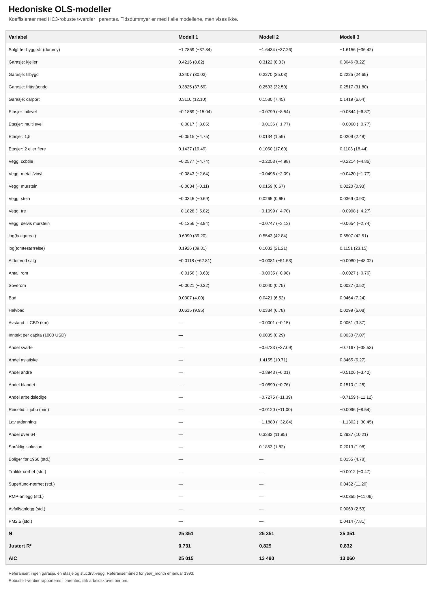{width="100%"}

## Sammenligning av modellene

Justert R² øker fra 0,731 i modell 1 til 0,829 i modell 2 og 0,832 i modell 3.
AIC faller fra 25 015 til 13 490 og deretter til 13 060, mens BIC faller fra 25 772 til 14 336 og 13 956.

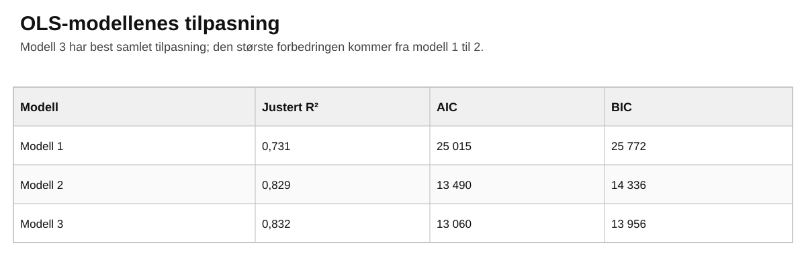{width="95%"}

Den robuste F-testen av de nestede modellene viser at modell 2 gir en klar forbedring sammenlignet med modell 1 (F = 879,7, p \< 0,001), og at modell 3 også forbedrer modell 2 (F = 61,2, p \< 0,001).
Modell 3 har dermed best samlet modelltilpasning, men den klart største forbedringen kommer når nabolagsvariablene legges til i modell 2.

Diagnoseplottene for modell 3 viser heteroskedastisitet og tunge haler i residualfordelingen, men ingen observasjoner med spesielt høy leverage.
Breusch-Pagan-testen bekrefter at variansen ikke er konstant.
Derfor bygger de statistiske testene i OLS-delen på robuste standardfeil.

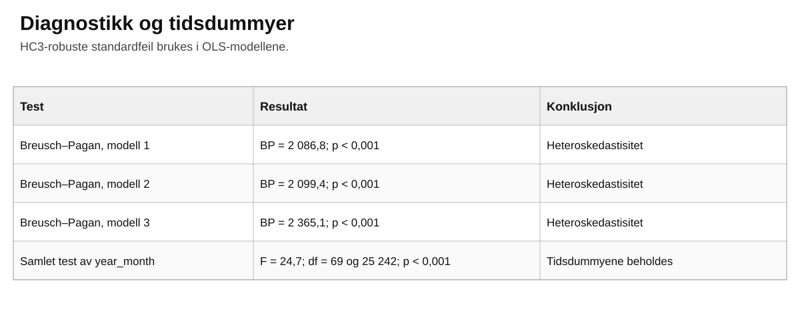{width="95%"}

I modell 3 er arealelastisiteten omtrent 0,55, slik at 1 % større boligareal henger sammen med omtrent 0,55 % høyere pris.
Elastisiteten for tomtestørrelse er omtrent 0,12.
Hvert ekstra år i boligaldren henger sammen med omtrent 0,8 % lavere pris.
Et ekstra bad henger sammen med omtrent 4,7 % høyere pris.
Inntekt per capita har en positiv sammenheng med pris, mens arbeidsledighet, lav utdanning og lengre reisetid til arbeid har negative sammenhenger.

Miljøresultatene er mer blandede.
Nærhet til Superfund-områder og PM2,5 har positive koeffisienter, mens nærhet til RMP-anlegg har et negativt fortegn.
Flere av fortegnene er motsatt av det man kunne forvente dersom miljøbelastning isolert sett reduserer boligprisen.
Resultatene tolkes derfor som betingede sammenhenger, ikke som kausale effekter.
Dette er særlig viktig fordi miljødataene er fra 2015, mens boligsalgene er fra 1993-1998 [@bishop2020].

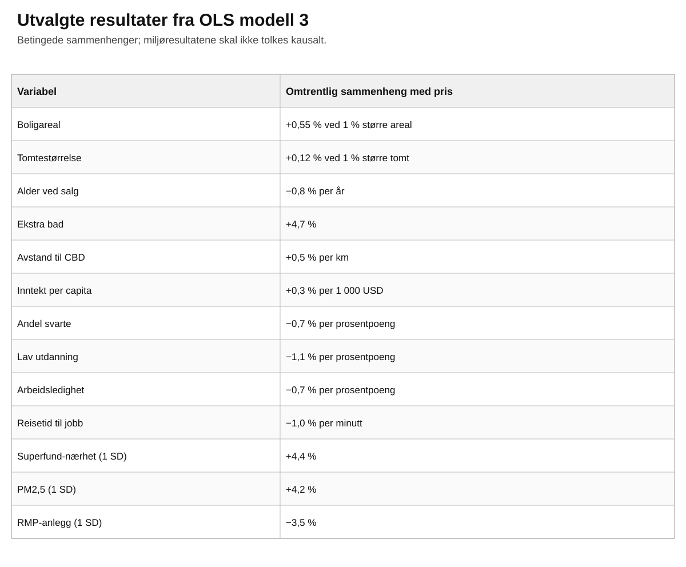{width="95%"}

# Prisutvikling over tid

Salgene strekker seg over flere år, og vi tester derfor om tidsdummyene i `year_month` samlet har betydning for prisen.
Nullhypotesen er at alle tidsdummykoeffisientene er lik null.
Den simultane testen er gjennomført med HC3-robuste standardfeil.

Testen gir F = 24,7 med 69 og 25 242 frihetsgrader og p \< 0,001.
Nullhypotesen forkastes.
Tidsdummyene har dermed samlet betydning for boligprisen og bør beholdes i modellene.

Januar 1993 er referansemåned.
Hver tidsdummy viser forskjellen i logaritmisk pris mellom den aktuelle måneden og januar 1993 for ellers like boliger.
Den eksakte prosentvise forskjellen er $100(e^{\beta}-1)$ %.
Siden prisene er i løpende dollar, inneholder utviklingen også generell prisvekst.

# Romlige modeller

## Modeller og romlig vektmatrise

Boligene er punktobservasjoner, og vi bruker k-nærmeste naboer som romlig vektmatrise.
Vi bruker både k = 3 og k = 10 og radstandardiserte vekter, slik at det romlige laget kan tolkes som gjennomsnittet av naboenes verdier [@bivand2013].
Den romlige modellen inneholder de samme forklaringsvariablene som modell 3 og inkluderer dermed områdevariabler for både inntekt og etnisitet.

De aktuelle modellene er OLS, SEM, SAR, SLX og SDEM.
SEM modellerer romlig avhengighet i feilleddet.
SAR inkluderer en romlig lagget avhengig variabel.
SLX inkluderer romlig laggede forklaringsvariabler, mens SDEM kombinerer laggede forklaringsvariabler med en romlig feilprosess [@lesage2014; @maslianskaia-pautrel2016].
I SLX og SDEM brukes Durbin-ledd for `log(TLA)`, `log(lotsize)`, `age_sold`, `inntekt_1000`, `andel_svart` og `PM25_z`, slik at tidsdummyene ikke får egne impacts.

## Moran's I for OLS-residualene

Vi bruker `lm.morantest()` og Moran-plott for å undersøke om de hedoniske OLS-modellene etterlater uforklarte romlige effekter.
Nullhypotesen er fravær av romlig autokorrelasjon i residualene.

Moran's I er positiv og signifikant på p \< 0,001 for alle tre modellene og begge vektmatrisene.
I modell 1 er Moran's I 0,494 ved k = 3 og 0,467 ved k = 10.
I modell 2 faller verdiene til 0,377 og 0,333, mens modell 3 gir 0,369 og 0,325.
Nabolagsvariablene reduserer dermed den romlige autokorrelasjonen, men en tydelig romlig struktur gjenstår.

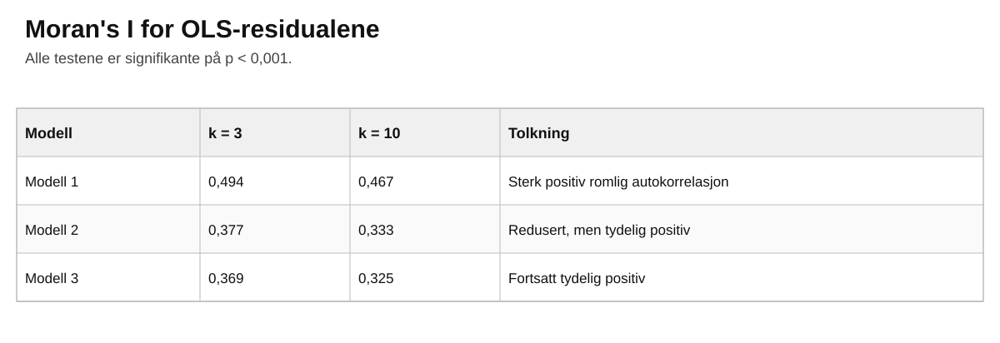{width="95%"}

Dette viser at OLS ikke er tilstrekkelig til å fange opp all romlig avhengighet, og vi går derfor videre med romlige regresjonsmodeller.

## Valg av romlig modell

Rao's Score-testene brukes etter Anselins Specific-to-General-tilnærming.
Både feil- og lagtestene er signifikante, men de robuste testene gir ulik konklusjon avhengig av k.
For k = 3 er den robuste lagtesten sterkest (adjRSlag = 1 315,9 mot adjRSerr = 526,9), og metoden peker mot SAR.
For k = 10 er den robuste feiltesten sterkest (adjRSerr = 4 936,2 mot adjRSlag = 1 757,3), og metoden peker mot SEM.
Alle disse testene har p \< 0,001.

Før de nestede modellene sammenlignes vurderer vi om fenomenet primært er lokalt eller globalt.
Boliger prises i et lokalt marked der kjøpere sammenligner boliger og nabolag i nærheten.
Det gjør lokale spillover-effekter gjennom forklaringsvariablene plausible.
Samtidig kan prisene påvirke hverandre gjennom sammenlignbare salg, noe som kan gi globale tilbakekoblinger.
Derfor sammenligner vi både SLX/SDEM og SAR, men bruker LeSages nestede modelltilnærming for å teste om den mer generelle SDEM-modellen kan forenkles.

Likelihood ratio-testene foretrekker SDEM framfor både SEM og SLX for k = 3 og k = 10.
For eksempel er LR-testen SDEM mot SEM 634,8 ved k = 3 og 389,6 ved k = 10, mens SDEM mot SLX gir 5 294,5 og 7 082,5.
Alle har p \< 0,001.
SDEM har også lavest AIC av de romlige modellene: omtrent 6 890 ved k = 3 og 4 878 ved k = 10.

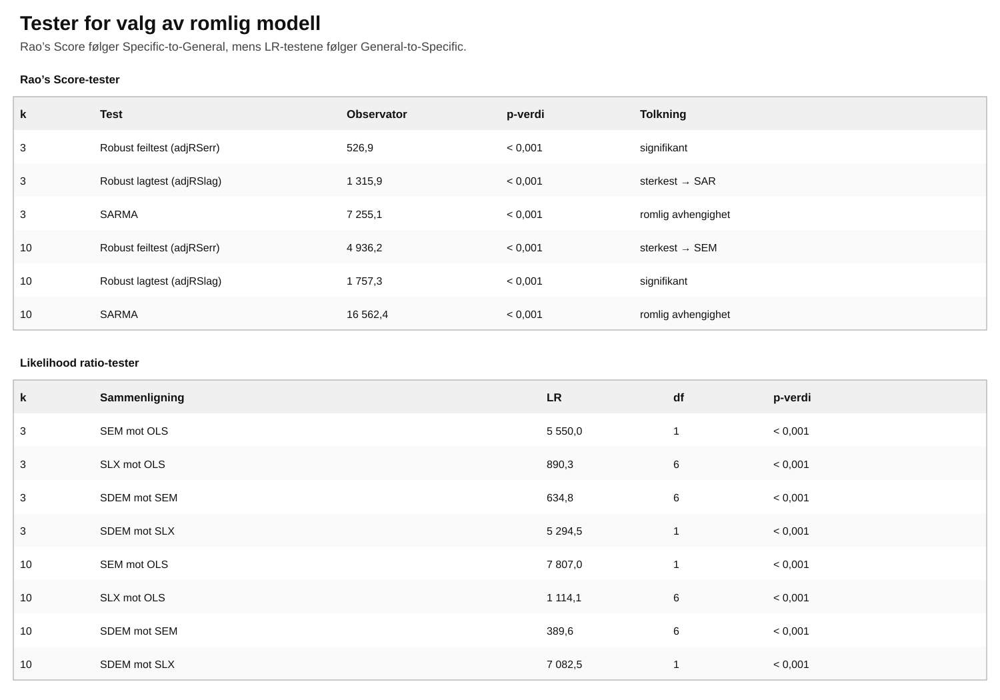{width="100%"}

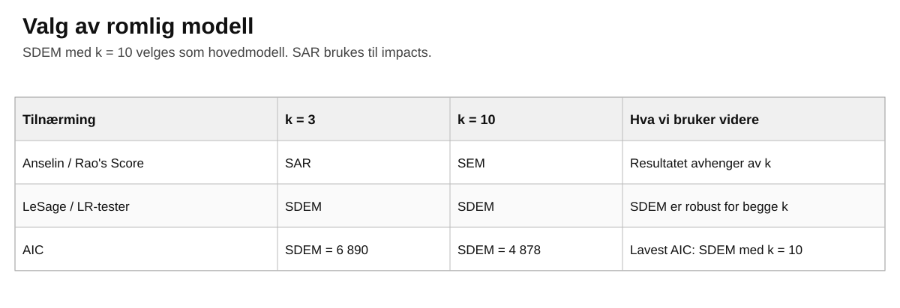{width="95%"}

Vi velger derfor SDEM med k = 10 som hovedmodell.
SAR beholdes som en viktig sammenligningsmodell fordi den gjør det mulig å beregne globale direkte og indirekte impacts.

## Romlig sammenheng etter modellering

For k = 10 bruker vi Moran-plott på residualene fra de ulike modellene.
Moran's I er 0,325 for OLS og 0,322 for SLX, slik at SLX nesten ikke reduserer residualautokorrelasjonen.
SAR reduserer den kraftig til omtrent 0,045.
De filtrerte residualene fra SEM og SDEM ligger nær null, med omtrent −0,020 og −0,018.

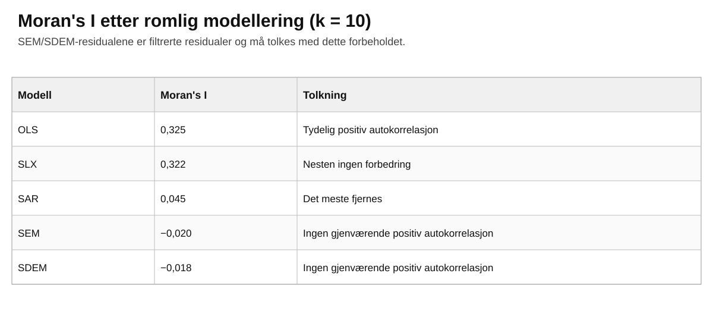{width="95%"}

Sammenligningen må tolkes med et viktig forbehold.
Residualene som returneres fra SEM og SDEM er filtrerte residualer, der den romlige feilprosessen er trukket ut.
Verdiene nær null viser derfor at modellen har filtrert bort den positive romlige autokorrelasjonen, men de kan ikke sammenlignes helt direkte med vanlige OLS-residualer.

## Direkte og indirekte effekter i SAR

I SAR-modellen kan ikke koeffisientene alene tolkes som fullstendige marginale effekter, fordi en endring i én observasjon kan påvirke andre observasjoner og deretter virke tilbake gjennom det romlige systemet.
Vi skiller derfor mellom direkte, indirekte og total effekt [@maslianskaia-pautrel2016].

For boligareal ved k = 10 er den direkte effekten omtrent 0,461, den indirekte effekten omtrent 0,488 og den totale effekten omtrent 0,949.
Dette betyr at 1 % større boligareal er forbundet med omtrent 0,46 % høyere pris direkte, mens den samlede effekten blir omtrent 0,95 % når den romlige propagasjonen tas med.

For inntekt per capita er direct impact omtrent −0,00182, indirect impact omtrent −0,00193 og total impact omtrent −0,00375.
Siden inntektsvariabelen måles per 1 000 dollar, tilsvarer dette omtrent −0,18 % direkte, −0,19 % indirekte og −0,37 % totalt per 1 000 dollar høyere inntekt i SAR-modellen.

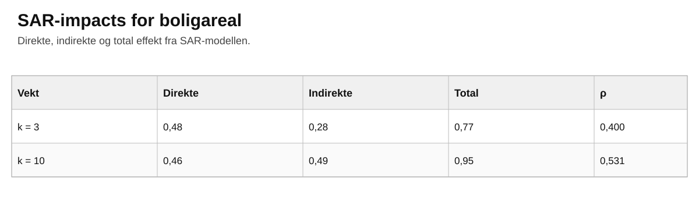{width="95%"}

Resultatene viser at spillover-effekten er viktig for begge variablene.
Samtidig har inntekt motsatt fortegn i SAR enn i OLS.
Dette viser at resultatet for inntekt er følsomt for hvordan den romlige avhengigheten modelleres, og bør derfor tolkes forsiktig.

# Diskusjon

## Tolkning av boligprismodellen

En hedonisk boligprismodell behandler boligen som en samling egenskaper.
Salgsprisen reflekterer dermed både fysiske boligegenskaper, beliggenhet, nabolag og miljøforhold.
Koeffisientene kan tolkes som implisitte priser på egenskapene når de andre variablene holdes konstante [@bishop2020; @maslianskaia-pautrel2016].

I vår OLS-analyse har boligareal en tydelig positiv sammenheng med pris.
Modell 3 har best tilpasning av OLS-modellene og en justert R² på 0,832.
Samtidig viser den romlige analysen at det fortsatt er tydelig romlig autokorrelasjon i OLS-residualene.
Den hedoniske tolkningen bør derfor kombineres med en modell som tar hensyn til den romlige strukturen.

## Hvorfor vi bruker romlige modeller

Boliger som ligger nær hverandre deler ofte nabolagsforhold, offentlige tjenester, miljøforhold og lokale markedsforhold.
Prisen på én bolig kan også inngå som informasjon når nærliggende boliger prises.
Observasjonene er derfor ikke nødvendigvis romlig uavhengige [@lesage2014; @maslianskaia-pautrel2016].

Dette ser vi direkte i resultatene.
For modell 3 er Moran's I for OLS-residualene 0,369 ved k = 3 og 0,325 ved k = 10, og begge er signifikante på p \< 0,001.
OLS har altså systematiske geografiske residualer som modellen ikke forklarer.
Dette er hovedgrunnen til at romlige regresjonsmodeller er nødvendige.

## Valg av romlig modell

Maslianskaia-Pautrel og Baumont beskriver tre tilnærminger til modellvalg: Specific-to-General, General-to-Specific og Story approach [@maslianskaia-pautrel2016].
Specific-to-General starter med OLS og tester om SAR eller SEM er nødvendig.
General-to-Specific starter med en mer generell modell og tester om den kan forenkles.
Story approach tar utgangspunkt i økonomisk teori og hva slags romlig prosess som virker mest rimelig.

I denne oppgaven har vi brukt både Specific-to-General og General-to-Specific.
Rao's Score-testene følger Anselins Specific-to-General-metode og peker mot SAR for k = 3, men SEM for k = 10.
LR-testene følger LeSages General-to-Specific-tilnærming og velger SDEM framfor SEM, SLX og OLS for både k = 3 og k = 10.
Story-tilnærmingen brukes også som støtte når vi vurderer lokale og globale spillover-effekter.

De empiriske metodene er enige om at OLS ikke er tilstrekkelig, men de er ikke helt enige om den nøyaktige romlige modellen.
Fordi SDEM velges for begge k, har lavest AIC samlet ved k = 10 og gir filtrerte residualer uten gjenværende positiv autokorrelasjon, bruker vi SDEM med k = 10 som foretrukket modell.

## Tolkning av resultatene

For å sammenligne modellene velger vi boligareal (`log(TLA)`) og inntekt per capita (`inntekt_1000`).
Den første beskriver selve boligen, mens den andre beskriver området boligen ligger i.

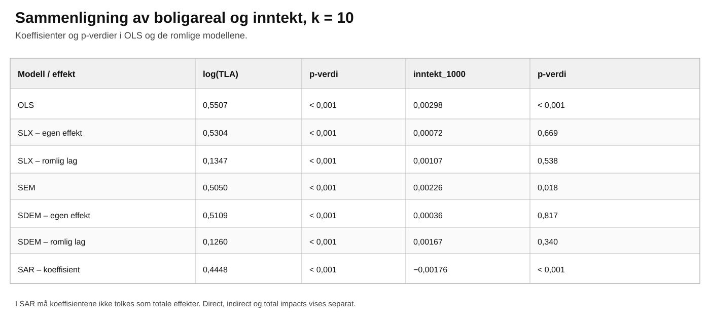{width="95%"}

Boligareal er svært stabilt på tvers av modellene.
OLS-koeffisienten er 0,5507 og er statistisk signifikant på p \< 0,001.
I SEM er koeffisienten 0,5050, mens SDEM gir en egen effekt på 0,5109 og en positiv romlig lag-effekt på 0,1260.
Begge er signifikante på p \< 0,001.
SLX viser samme mønster, med en egen effekt på 0,5304 og en romlig lag-effekt på 0,1347, begge signifikante.
SAR-koeffisienten er lavere, 0,4448, men også klart signifikant.
SAR-koeffisienten skal likevel ikke tolkes som den totale effekten, fordi tilbakekoblinger gjennom boligmarkedet må tas med gjennom impacts.

Resultatet for inntekt er mindre stabilt.
I OLS er koeffisienten 0,00298 og signifikant på p \< 0,001.
Det tilsvarer omtrent 0,30 % høyere boligpris når inntekt per capita øker med 1 000 dollar, alt annet likt.
I SEM er koeffisienten fortsatt positiv, 0,00226, og signifikant på 5 %-nivå (p = 0,018).

Når lokale spillover-effekter tas med, blir bildet annerledes.
I SLX er egen koeffisient for inntekt 0,00072 (p = 0,669) og den romlig laggede koeffisienten 0,00107 (p = 0,538).
I den foretrukne SDEM-modellen er egen koeffisient 0,00036 (p = 0,817), mens den romlig laggede koeffisienten er 0,00167 (p = 0,340).
Ingen av disse inntektskoeffisientene er statistisk signifikante.
I SAR skifter koeffisienten fortegn til −0,00176 og er statistisk signifikant på p \< 0,001.

Sammenligningen viser derfor to forskjellige historier.
Sammenhengen mellom boligareal og pris er positiv, sterk og robust uansett romlig modell.
Inntekt per capita er derimot følsom for modellvalget.
Siden SDEM med k = 10 er vår foretrukne modell, finner vi ikke en statistisk sikker egen eller lokal spillover-effekt av inntekt i hovedmodellen.
Det ville derfor vært misvisende å konkludere med en stabil positiv inntektseffekt bare ut fra OLS-resultatet.

## Direkte og indirekte effekter

Spatial impacts viser hvordan en endring i en forklaringsvariabel virker både på den aktuelle boligen og gjennom resten av det romlige systemet.
Den direkte effekten inkluderer effekten på boligen selv og tilbakekoblinger.
Den indirekte effekten er spillover-effekten på andre boliger, mens total effekt er summen av direkte og indirekte effekt [@maslianskaia-pautrel2016].

For boligareal ved k = 10 er den direkte effekten 0,461, den indirekte effekten 0,488 og den totale effekten 0,949.
Den totale effekten er dermed betydelig større enn SAR-koeffisienten på 0,4448.
Dette skyldes at en endring kan påvirke andre boliger og deretter virke tilbake gjennom det romlige systemet.

For inntekt per capita er den direkte effekten omtrent −0,00182, den indirekte effekten omtrent −0,00193 og total impact omtrent −0,00375.
Omregnet betyr dette omtrent −0,18 %, −0,19 % og −0,37 % per 1 000 dollar høyere inntekt.
At dette har motsatt fortegn av OLS, samtidig som inntekt ikke er signifikant i SDEM, understreker at inntektsresultatet er følsomt for den romlige modellspesifikasjonen.

Det er derfor impacts, og ikke bare SAR-koeffisienten, som bør brukes når den økonomiske effekten i SAR skal tolkes.

# Oppsummering

Analysen viser at både boligegenskaper og nabolagsforhold har sammenheng med boligprisene i Lucas County.
Modell 3 er den beste av OLS-modellene, men Moran's I viser at residualene fortsatt er tydelig romlig autokorrelerte.
Vanlig OLS fanger derfor ikke opp hele den geografiske strukturen i boligmarkedet.

De romlige testene gir noe ulike svar.
Rao's Score-testene peker mot SAR ved k = 3 og SEM ved k = 10, mens likelihood ratio-testene velger SDEM for begge vektmatrisene.
SDEM med k = 10 har lavest AIC samlet og fjerner den positive residualautokorrelasjonen, og velges derfor som hovedmodell.

Sammenligningen av de to valgte variablene viser at boligareal har en stabil positiv og signifikant sammenheng med boligprisene i alle modellene.
Inntekt per capita er mindre robust: den er positiv og signifikant i OLS og SEM, men ikke signifikant i SLX eller den foretrukne SDEM-modellen, og får negativt fortegn i SAR.
SAR-analysen viser samtidig at både direkte og indirekte effekter kan være viktige.
Resultatene viser samlet at boligprisene i Lucas County bør forstås som del av et romlig sammenkoblet boligmarked, og at konklusjonene kan avhenge av hvordan den romlige avhengigheten modelleres.

# Referanser

::: {#refs}
:::

## Bruk av kunstig intelligens

I arbeidet med oppgaven har vi brukt ChatGPT som et støtteverktøy.
Verktøyet har blant annet blitt brukt til språklig forbedring, strukturering av teksten, forklaring av statistiske og romlige metoder og feilsøking av R-kode.
ChatGPT har også blitt brukt som støtte i arbeidet med å tolke resultater og kontrollere at de ulike delene av arbeidskravet er besvart.

Alle analyser og resultater som presenteres i oppgaven er kontrollert mot egne beregninger i R og GeoDa, og faglige vurderinger er gjort med utgangspunkt i pensumlitteraturen og kildene som er oppgitt i referanselisten.
Vi er selv ansvarlige for innholdet, tolkningene og konklusjonene i oppgaven.
